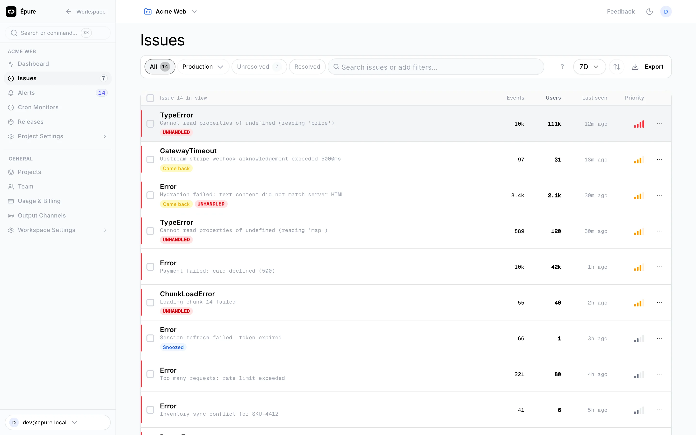
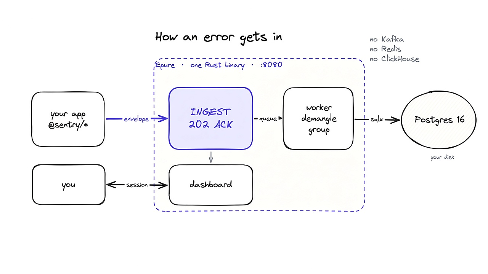

<p align="center">
  
</p>

<p align="center">
  <a href="https://github.com/epure-sh/epure/actions/workflows/ci.yml"></a>
  <a href="https://github.com/epure-sh/epure/actions/workflows/image.yml"></a>
  <a href="https://github.com/epure-sh/epure/releases/latest"></a>
  <a href="LICENSE"></a>
  <a href="https://www.rust-lang.org/"></a>
  <a href="https://www.postgresql.org/"></a>
</p>

# Epure

Calm error tracking for SaaS built by one or two developers. Each new bug shows once, alerts fire only on a new issue, a regression or a spike, and the bill is flat.

- **Keep your Sentry SDK.** Change the DSN to Epure and set `tracesSampleRate: 0`. To roll back, restore the old DSN.
- **Your coding agent reads the issue.** `claude mcp add epure -- npx -y @epure-sh/mcp`, or the hosted server at `https://app.epure.sh/mcp`.
- **Agent skills.** `npx skills add epure-sh/epure` for any agent. In Claude Code, `/plugin marketplace add epure-sh/epure`, then `/plugin install epure@epure`: it adds the skills and the hosted MCP server.
- **Pricing.** Self-hosting is free. Cloud Pro is $29 a month, Scale $89, monthly, unlimited seats, no automatic overage: [epure.sh/pricing](https://epure.sh/pricing).
- **Licence.** Engine AGPL-3.0. The `@epure-sh/cli` and `@epure-sh/mcp` clients are Apache-2.0.

| Two containers | One flood, one issue | Errors only |
| :--- | :--- | :--- |
| **Epure plus Postgres 16.** Idle about 5 MiB plus 48 MiB, measured 23 Sep 2026. | **Spike valve.** 100 stored per minute per identical error, 150 per throw site, every repeat counted. | **No tracing, replay or profiling.** Keep those sample rates at 0 in the SDK. |

## From clone to Issues


Docs: [architecture, deploy, and DSN migration](https://epure.sh/docs).

## Quickstart

**1. Start it**

```bash
git clone https://github.com/epure-sh/epure.git
cd epure
docker compose up -d
```

**2. Copy the DSN**

Open [http://localhost:8080](http://localhost:8080). Register, create a project, copy the DSN.

**3. Throw one error**

Keep the official Sentry SDK. Paste the Epure DSN. Set tracing, replay, and profiling sample rates to **0** (Epure does not store those payloads).

```javascript
import * as Sentry from "@sentry/node";

Sentry.init({
  dsn: process.env.SENTRY_DSN, // DSN from step 2
  sendDefaultPii: false,
  tracesSampleRate: 0,
  replaysSessionSampleRate: 0,
  replaysOnErrorSampleRate: 0,
  profilesSampleRate: 0,
});

Sentry.captureException(new Error("Epure test event"));
```

**4. Open Issues**

`Epure test event` is on the page. Grouped, with the stack.

Other languages, same DSN: [Pick your SDK](https://epure.sh/docs/platforms). It also lives under **Settings → SDK connection**, and the in-app **Setup** wizard shows it.

## Deploy

**On a VPS**

```bash
./configure --prod
docker compose -f docker-compose.yml -f deploy/docker-compose.prod.yml --profile tls up -d
```

Run `./configure --prod` **before** the first `up`, or after `docker compose … down -v`. If Postgres data already exists, the script **reuses** secrets from `.env` or **applies** new ones into the database — it does not overwrite `.env` with fresh random passwords while leaving the volume on the old ones. To rotate secrets intentionally: `./configure --prod-rotate-secrets`. `./configure --prod` asks for a public HTTPS hostname (not a raw IP). `--profile tls` starts Caddy on ports 80 and 443. Open `https://your-hostname/login` and repeat steps 2 to 4.

`http://YOUR_SERVER:8080` will not keep you signed in. `/health` can still return ok. The browser drops the Secure session cookie and sends you back to the login form with no error. Drop `--profile tls` only when you already terminate HTTPS yourself.

After that account exists, set `EPURE_REGISTRATION=false` and recreate the container. Sign-in stays available. New workspaces cannot be created from the public URL. Invitation links still work.

What this binary stores, and what it refuses to store, is in [docs/privacy.md](docs/privacy.md). The sign-in page links to `/privacy`.

Pin `EPURE_IMAGE` to the current release tag once the URL is public ([Releases](https://github.com/epure-sh/epure/releases) · [Installation](https://epure.sh/docs/self-hosting/installation)).

**On a platform**

| Platform | Start here |
| --- | --- |
| Render | Blueprint [`render.yaml`](render.yaml). |
| Railway | Drag [`deploy/railway/docker-compose.yml`](deploy/railway/docker-compose.yml) onto the project. [Notes](deploy/railway/README.md). |
| Coolify | Compose, base directory [`deploy/templates/coolify`](deploy/templates/coolify). |
| Dokploy | Compose file [`deploy/templates/dokploy/docker-compose.yml`](deploy/templates/dokploy/docker-compose.yml). |

Then the same steps: register, copy the DSN, throw once, open **Issues**. Longer list: [Installation](https://epure.sh/docs/self-hosting/installation) · [`deploy/`](deploy/README.md).

## Architecture

Two containers. The SDK talks to ingest; ingest returns 202 and a worker writes Postgres. The dashboard is the same binary.

<p align="center">
  
</p>

---

## Details

* Grouped issues and readable stack traces
* JS/TS sourcemaps
* Releases and regressions
* Alerts and webhooks
* Multi-project orgs and DSN rotation
* RBAC and PostgreSQL RLS
* Keyboard triage
* Spike protection

Epure does not store distributed traces, session replay, continuous profiling, generic logs, or infrastructure metrics. It does not symbolicate iOS/Android. Keep those sample rates at 0 in the SDK.

|  | Epure | Bugsink | Sentry self-hosted | GlitchTip |
| --- | --- | --- | --- | --- |
| **Primary focus** | Error tracking | Self-hosted error tracking | Errors plus tracing, replay, profiling | Errors and performance |
| **Deployment** | Two-container Compose | Single-container `docker run` | Large multi-service cluster | Multiple options |
| **License** | AGPL-3.0 engine, Apache-2.0 CLI/MCP. No `ee/` folder | PolyForm Shield 1.0.0 | Check current Sentry license | MIT |
| **Database** | PostgreSQL 16 | See their docs | Multiple datastores | PostgreSQL |

**Project status:** v0.2.2, first released 23 Sep 2026. Epure Cloud runs this engine in production; open release gates (published capacity results, grouping quality measurement) are tracked in [docs/ingester-audit.md](docs/ingester-audit.md). Two-container Compose, PostgreSQL 16 with RLS, Spike Valve flood protection, and official Sentry SDK wire compatibility. [Changelog](CHANGELOG.md).

* [Report an Issue](https://github.com/epure-sh/epure/issues)
* [Join Discussions](https://github.com/epure-sh/epure/discussions)
* [Read CONTRIBUTING.md](CONTRIBUTING.md)
* [Security Policy](.github/SECURITY.md)

**License:** the engine (Rust crates and web UI) is [GNU AGPL-3.0](LICENSE). The client packages [`@epure-sh/cli`](packages/epure-cli/LICENSE) and [`@epure-sh/mcp`](packages/epure-mcp/LICENSE) stay Apache-2.0, so installing them never affects your code. Releases up to v0.1.7 were Apache-2.0. No separate closed-source core.
